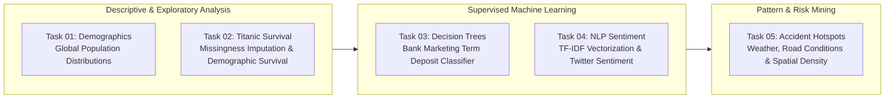

# Prodigy InfoTech — Data Science Internship

[](https://www.python.org/)
[](https://pandas.pydata.org/)
[](https://numpy.org/)
[](https://scikit-learn.org/)
[](https://seaborn.pydata.org/)
[]()

A comprehensive suite of five data science and machine learning projects developed during the **Prodigy InfoTech Data Science Internship**. The repository covers end-to-end analytical pipelines: data ingestion, cleaning, exploratory data analysis (EDA), predictive supervised classification, natural language processing (NLP), and geospatial accident analysis.

---

## 🗺️ Internship Project Spectrum



---

## 📋 Task Summaries & Methodologies

### [Task 01: Population Distribution & Demographics](Task-01/)
* **Objective:** Clean, aggregate, and visualize continuous and categorical global population distributions.
* **Tech Stack:** `Pandas`, `Matplotlib`, `Seaborn`.
* **Methodology:** Filtered multi-decade World Bank indicators, computed top 10 most populous nations, and visualized population distributions via bar charts and histogram distributions.
* **Key Artifact:** `Task-01/outputs/top_10_population.png`.

---

### [Task 02: Titanic Passenger Survival EDA](Task-02/)
* **Objective:** Perform robust data cleaning, missing value imputation, and bivariate survival exploration on the classic Titanic dataset.
* **Key Insights:** Handled missing age records using median imputation by passenger class; quantified survival odds across sex, class hierarchy ($P(S \mid \text{Female}) \gg P(S \mid \text{Male})$), and family size.
* **Key Artifacts:** `Task-02/outputs/age_distribution.png`, `survival_by_class.png`, `survival_by_sex.png`.

---

### [Task 03: Bank Marketing Term-Deposit Prediction](Task-03/)
* **Objective:** Build an interpretable Decision Tree classifier predicting whether institutional clients subscribe to term deposits based on direct marketing campaigns.
* **Machine Learning Pipeline:** Label encoding of categorical features, stratified train/test split ($80/20$), hyperparameter pruning (max depth limits), and confusion matrix assessment.
* **Key Metrics:** Precision, Recall, F1-Score, and tree graph visualization.
* **Key Artifact:** `Task-03/outputs/confusion_matrix.png`, `decision_tree.png`.

---

### [Task 04: Social Media Sentiment Analysis (NLP)](Task-04/)
* **Objective:** Classify Twitter sentiment patterns across user brands and gaming communities into Positive, Neutral, Negative, and Irrelevant.
* **NLP Pipeline:** Text normalization, stopword filtering, TF-IDF ngram vectorization, and multi-class Logistic Regression modeling.
* **Key Artifact:** `Task-04/outputs/sentiment_distribution.png`, `confusion_matrix.png`.

---

### [Task 05: Traffic Accident Hotspot & Weather Pattern Analysis](Task-05/)
* **Objective:** Mine high-volume spatial and temporal traffic accident patterns across the United States.
* **Analysis Focus:**
  * **Temporal Trends:** Peak incident volume correlated with morning and evening rush hour spikes.
  * **Environmental Impact:** Accident severity distributions across rain, fog, snow, and clear conditions.
  * **Infrastructure Factors:** Traffic signals, crossings, and junction density analysis.
* **Key Artifacts:** `Task-05/outputs/accidents_by_weather.png`, `geographic_hotspots.png`, `accidents_by_time_of_day.png`.

---

## ⚡ Quickstart: Running Any Task

### Prerequisites
Install all core data science and machine learning packages:

```bash
pip install pandas numpy scikit-learn matplotlib seaborn
```

### Run an Individual Task Pipeline

```bash
# Clone the repository
git clone https://github.com/shutkarshX/Prodigy-Infotech.git
cd Prodigy-Infotech

# Run Task 01 (Demographics)
python Task-01/task_01.py

# Run Task 02 (Titanic EDA)
python Task-02/task_02.py

# Run Task 03 (Decision Tree Classification)
python Task-03/task_03.py

# Run Task 04 (Twitter NLP Sentiment)
python Task-04/task_04.py

# Run Task 05 (Accident Hotspots Analysis)
python Task-05/task_05.py
```
*Generated plots and statistical tables are automatically saved under each task's `outputs/` folder.*

---

## 📁 Repository Structure

```text
Prodigy-Infotech/
├── Task-01/                   # World Bank Demographics & Population EDA
│   ├── dataset/
│   ├── outputs/
│   ├── task_01.py
│   └── README.md
├── Task-02/                   # Titanic Passenger Survival EDA & Imputation
│   ├── dataset/
│   ├── outputs/
│   ├── task_02.py
│   └── README.md
├── Task-03/                   # Bank Marketing Decision Tree Classifier
│   ├── dataset/
│   ├── outputs/
│   ├── task_03.py
│   └── README.md
├── Task-04/                   # Twitter TF-IDF Sentiment Classification
│   ├── dataset/
│   ├── outputs/
│   ├── task_04.py
│   └── README.md
├── Task-05/                   # Geospatial US Traffic Accident Analysis
│   ├── dataset/
│   ├── outputs/
│   ├── task_05.py
│   └── README.md
├── .gitignore
└── README.md
```

---

## 🏷️ Milestone Git Tags
Each individual task milestone has been preserved with permanent GitHub tags for traceability:
* `task-01` · `task-02` · `task-03` · `task-04` · `task-05`
